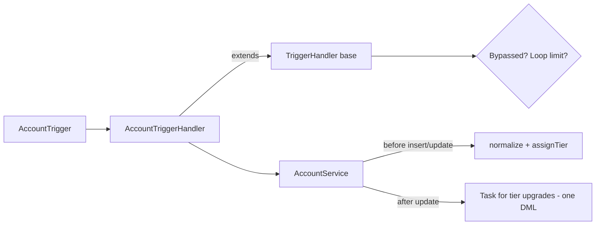

# Apex Trigger Framework (one trigger per object, bulk-safe services)


## Business problem

Orgs that grow without a trigger pattern end up with several triggers per object, logic in the trigger body, recursion bugs, and code that breaks the first time a data load sends 200 records at once. This project shows the structure I use to keep trigger logic testable, bulk-safe and easy to switch off during data migrations.

## Tech stack

Apex, Salesforce DX, Prettier (Apex parser), GitHub Actions

## Architecture



## What it demonstrates

- `TriggerHandler`: context dispatch via `switch on Trigger.operationType`, per-handler bypass (for data loads), and a re-entry guard that throws after a configurable loop count.
- `AccountService`: list-in methods only, so no SOQL or DML inside loops. One DML for any batch size.
- Tier is recalculated only when `AnnualRevenue` actually changes, which avoids overwriting manual updates.
- Tests insert 200 records to prove bulk safety, and cover bypass, boundaries and misuse outside a trigger.

## Project layout

| Path | Purpose |
| --- | --- |
| `force-app/main/default/classes/TriggerHandler.cls` | Reusable base class |
| `force-app/main/default/classes/AccountTriggerHandler.cls` | Object-specific handler |
| `force-app/main/default/classes/AccountService.cls` | Business rules |
| `force-app/main/default/triggers/AccountTrigger.trigger` | The single trigger |
| `force-app/main/default/classes/AccountTriggerHandlerTest.cls` | Bulk and edge-case tests |
| `data/sample-accounts.csv` | Synthetic sample data |

## Run it yourself

Prerequisites: [Salesforce CLI](https://developer.salesforce.com/tools/salesforcecli), a Dev Hub org (a free Developer Edition org with Dev Hub enabled works), Node.js 20+.

```bash
sf org login web --set-default-dev-hub --alias devhub
sf org create scratch --definition-file config/project-scratch-def.json --alias demo --set-default --duration-days 7
sf project deploy start
sf apex run test --test-level RunLocalTests --code-coverage --result-format human --wait 20
sf data import bulk --sobject Account --file data/sample-accounts.csv --wait 5
```

## CI

`.github/workflows/ci.yml` runs on every push and pull request:

1. **Static checks**: Prettier with the Apex parser (this fails on any Apex syntax error).
2. **Apex tests in a scratch org**: runs only if the repository owner adds a `SFDX_AUTH_URL` secret (Settings > Secrets and variables > Actions). Get the value with `sf org display --verbose --target-org devhub` (the "Sfdx Auth Url" line). **Never commit it.**

## Security notes

- No credentials, endpoints, org IDs or tokens are stored in this repository. `.gitignore` blocks common secret files.
- Apex runs `with sharing`, and queries and DML use `USER_MODE` so object-, field- and record-level security is enforced.

## Limitations and next steps

- Bypass is in-memory (per transaction). A production version would also read a Custom Permission or Custom Metadata switch.
- Only Account is wired up. Adding an object takes one trigger, one handler and one service.

## About this project

This is an independent portfolio project. It demonstrates patterns I have used on enterprise Salesforce engagements, rebuilt from scratch on the standard data model with synthetic data. It contains no client or employer code, data, object names or configuration. It was developed with AI-assisted tooling and reviewed by me.

## License

MIT. See [LICENSE](LICENSE).

